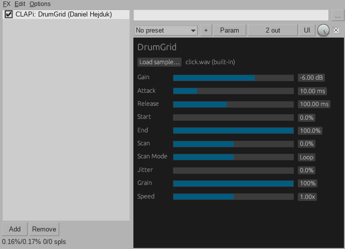

# DrumGrid

## Description
An open-source CLAP/VST3 plugin for your DAW that turns any sample into a playable tone by retriggering it at the note's frequency.
## Building
You need a stable rust toolchain installed, after that run this command:
```bash
cargo xtask bundle drumgrid --release
```
## How does it works
The sample is loaded into the plugin's memory. When a MIDI key is played the plugin plays that sample in the note's frequency. For example the A4 restarts the sample 440 times a second, so it sounds at 440 Hz.
## Usage notes
- Load a sound with the `Load sample...` button. There is a built-in one baked in.
- In only accepts WAV files, mono or stereo.
- Files up to 16 MB are embedded inside the project. Larger are saved as a file path.
- It plays up to 16 notes at once.
## Install
> Only Linux builds are supported right now
- Linux: `~/.clap`, `~/.vst3`
- MacOS: `~/Library/Audio/Plug-Ins/CLAP`, `~/Library/Audio/Plugins/VST3`
- Windows: `C:\Program Files\Common Files\CLAP`, `C:\Program Files\Common Files\VST3`
